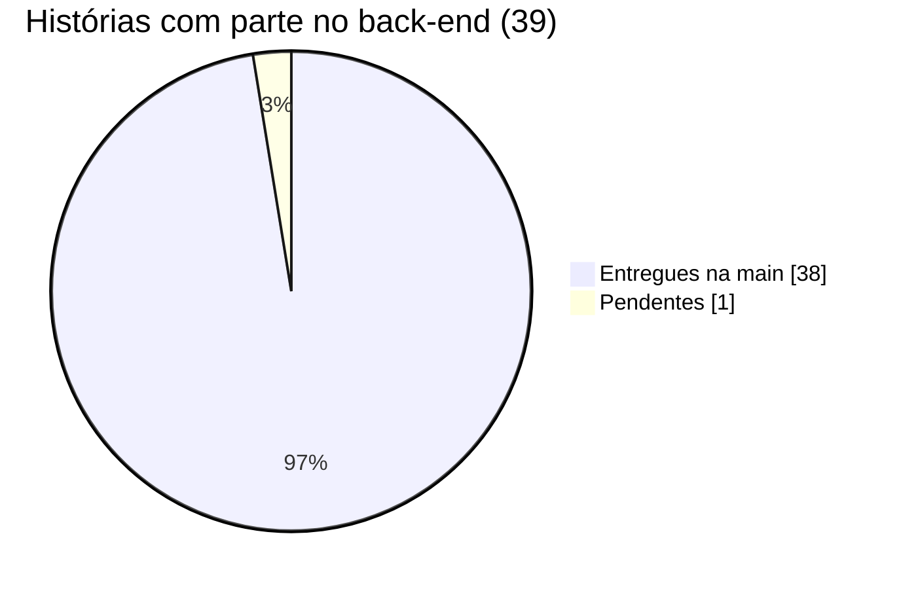

# Situação da entrega

Retrato do que foi construído até **26/10/2026**, conferido diretamente nos repositórios [`Advocondo/back`](https://github.com/Advocondo/back), [`Advocondo/front`](https://github.com/Advocondo/front) e [`Advocondo/docs`](https://github.com/Advocondo/docs): issues, pull requests, CI e a suíte de testes da `main`.

!!! abstract "Resumo"
    - **Back-end:** 38 das 39 histórias que têm parte no back estão na `main`; falta a [US40](../historias/ep06-painel-cliente.md#us40). Do MVP, **15 de 15** estão entregues.
    - **Qualidade:** 1019 testes automatizados passando, **99% de cobertura** e CI verde na `main`. A API tem 72 operações em 14 módulos.
    - **Front-end:** a base do projeto e o CI estão prontos, mas nenhuma tela de história chegou à `main`. A primeira, a [US12](../historias/ep03-cadastro-acordos.md#us12), está em revisão.
    - **Rastreabilidade:** 78 dos 81 critérios de aceitação das histórias entregues têm teste automatizado que cita o critério pelo identificador.

Os detalhes estão em três páginas:

- [Completude do backlog](backlog.md): a situação de cada história no back e no front, com o PR que a entregou.
- [Requisito → código → teste](../rastreabilidade/implementacao.md): cada critério de aceitação ligado ao módulo, às rotas e aos testes que o verificam.
- [Pendências e riscos](pendencias.md): o que falta, os riscos encontrados na conferência e a próxima ordem de trabalho.

## Placar das histórias

| Épico | Histórias | Back entregue | Critérios | Critérios com teste |
| --- | :---: | :---: | :---: | :---: |
| [EP01 · Portal & Autenticação](../historias/ep01-portal-autenticacao.md) | 6 | 5 de 5 | 14 | 11 |
| [EP02 · Gestão de Usuários](../historias/ep02-usuarios-perfis.md) | 5 | 5 de 5 | 13 | 13 |
| [EP03 · Cadastro de Acordos](../historias/ep03-cadastro-acordos.md) | 13 | 13 de 13 | 29 | 28 |
| [EP04 · Acompanhamento de Parcelas](../historias/ep04-parcelas.md) | 7 | 7 de 7 | 13 | 13 |
| [EP05 · Comissões e Metas](../historias/ep05-comissoes-metas.md) | 5 | 5 de 5 | 10 | 10 |
| [EP06 · Painel do Cliente](../historias/ep06-painel-cliente.md) | 4 | 3 de 4 | 8 | 3 |
| **Total** | **40** | **38 de 39** | **87** | **78** |

A [US01](../historias/ep01-portal-autenticacao.md#us01) (landing page) é só de front e por isso fica fora da conta do back. A coluna **Critérios** traz todos os critérios do épico, inclusive os das histórias ainda pendentes.

## MVP

O MVP segue a label `mvp` das issues: são 16 histórias, 15 delas com parte no back.

| Situação no back | Histórias |
| --- | --- |
| Entregues (15) | [US02](../historias/ep01-portal-autenticacao.md#us02) · [US07](../historias/ep02-usuarios-perfis.md#us07) · [US08](../historias/ep02-usuarios-perfis.md#us08) · [US09](../historias/ep02-usuarios-perfis.md#us09) · [US13](../historias/ep03-cadastro-acordos.md#us13) · [US15](../historias/ep03-cadastro-acordos.md#us15) · [US16](../historias/ep03-cadastro-acordos.md#us16) · [US17](../historias/ep03-cadastro-acordos.md#us17) · [US22](../historias/ep03-cadastro-acordos.md#us22) · [US25](../historias/ep04-parcelas.md#us25) · [US26](../historias/ep04-parcelas.md#us26) · [US27](../historias/ep04-parcelas.md#us27) · [US28](../historias/ep04-parcelas.md#us28) · [US32](../historias/ep05-comissoes-metas.md#us32) · [US36](../historias/ep05-comissoes-metas.md#us36) |
| Só front (1) | [US01](../historias/ep01-portal-autenticacao.md#us01) Landing page institucional |

## Ritmo de entrega

As histórias do back entraram na `main` em menos de duas semanas. A data é a do fechamento da issue pelo merge do PR.

| Data | Entregues no dia | Acumulado | Histórias |
| --- | :---: | :---: | --- |
| 17/10 | 4 | 4 | US02, US03, US05, US06 |
| 18/10 | 2 | 6 | US07, US08 |
| 20/10 | 4 | 10 | US09, US11, US12, US13 |
| 21/10 | 7 | 17 | US10, US15, US16, US17, US18, US25, US27 |
| 22/10 | 5 | 22 | US14, US23, US26, US36, US37 |
| 23/10 | 1 | 23 | US28 |
| 25/10 | 13 | 36 | US04, US19, US20, US22, US24, US29, US30, US31, US32, US33, US34, US35, US38 |
| 26/10 | 2 | 38 | US21, US39 |

Antes das histórias, a infraestrutura foi entregue em 30/09: CI, deploy, banco, segredos, testes, observabilidade, HTTPS e CORS. As migrations com Alembic entraram em 14/10.

## O que existe hoje

| Frente | Situação |
| --- | --- |
| **Back-end** ([`Advocondo/back`](https://github.com/Advocondo/back)) | FastAPI + PostgreSQL 18, organizado em camadas (ver [Arquitetura](../arquitetura/index.md) e [Banco de dados](../pc2/banco-de-dados.md)). Módulos por domínio: `auth`, `users`, `metas`, `condominios`, `devedores`, `acordos`, `documentos`, `parcelas`, `notificacoes`, `painel_admin`, `painel_operacional`, `painel_cliente`, `landing` e `common`. Cada um tem a sua página em `docs/` no repositório do back. |
| **Qualidade do back** | A cada push e PR, o CI roda gitleaks, ruff (lint e formato), mypy estrito, pytest com cobertura e o build da imagem de produção. A `main` é protegida por esses checks. |
| **Deploy** | Back na Oracle Cloud via Coolify, com as migrations no *pre-deployment command*. O front vai para a Vercel. Ver [Deploy](../infraestrutura/deploy.md). |
| **Front-end** ([`Advocondo/front`](https://github.com/Advocondo/front)) | Next.js com CI de lint, tipos, testes e build. O design system vem do pacote [`Advocondo/ui-kit`](https://github.com/Advocondo/ui-kit). A primeira tela (Condomínios, US12) está no [PR #46](https://github.com/Advocondo/front/pull/46). |
| **Documentação** | Este site: histórias, rastreabilidade, protótipos, design system, validação e o acompanhamento da entrega. |

## Como os números foram obtidos

- **Situação das histórias:** cada história tem uma issue no back e outra no front. Uma história conta como entregue quando a issue foi fechada pelo merge de um PR na `main`. Toda issue fechada do back tem esse PR.
- **Testes e cobertura:** `uv run pytest` na `main` do back (commit `3de444f`, de 26/10) e o último run do CI na `main`.
- **Critério com teste:** há pelo menos um teste cuja docstring ou id cita o critério (`"""US13-CA01"""`). É a convenção do time; um critério pode estar testado sem a marcação, e esses casos estão em [Pendências e riscos](pendencias.md).
- **Rotas:** o esquema OpenAPI gerado pela própria API.

---

## Histórico de versão

| Versão | Data | Descrição | Autor |
| :----: | :--: | :-------: | :---: |
| 1.0 | 25/10/2026 | Criação da página com o retrato da entrega em 25/10/2026. | Mateus Vieira |
| 1.1 | 25/10/2026 | Links para as páginas de Arquitetura e Banco de dados. | Mateus Vieira |
| 1.2 | 26/10/2026 | Retrato atualizado para 26/10: 38 de 39 histórias no back, MVP completo no back, 1019 testes e 99% de cobertura, 78 de 81 critérios com teste. | Ciro Costa |
