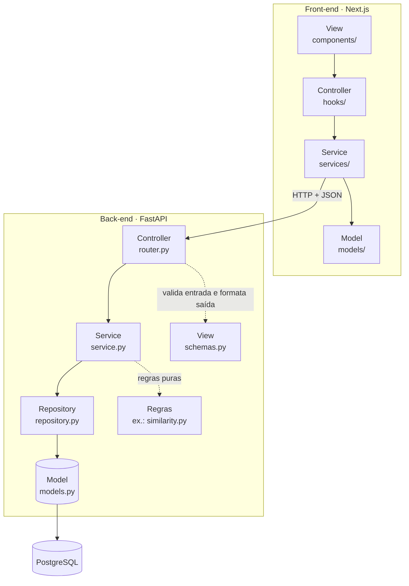

# Arquitetura

O Advocondo segue **MVC + Camadas**, no back-end e no front-end. Cada domínio (condomínios, devedores, acordos...) é uma pasta com **sempre os mesmos arquivos**, e cada camada só conversa com a camada de baixo. Assim, quem abre um módulo novo já sabe onde procurar cada coisa.

| | Back-end | Front-end |
| --- | --- | --- |
| Stack | Python 3.13, FastAPI, SQLAlchemy 2, PostgreSQL 18, Alembic | Next.js (App Router), TypeScript, design system [`Advocondo/ui-kit`](https://github.com/Advocondo/ui-kit) |
| Repositório | [`Advocondo/back`](https://github.com/Advocondo/back) | [`Advocondo/front`](https://github.com/Advocondo/front) |
| Publicação | Oracle Cloud via Coolify (ver [Deploy](../infraestrutura/deploy.md)) | Vercel |

## Fluxo de uma requisição

## Back-end

Cada domínio fica em `src/advocondo/<dominio>/`, com estes arquivos:

| Arquivo | Papel no MVC | Responsabilidade | Não faz |
| --- | --- | --- | --- |
| `router.py` | Controller | Recebe a requisição HTTP, aplica a permissão (`require_office_staff`, `CurrentAdmin`...), chama o service e converte o resultado em schema | Regra de negócio, consulta ao banco |
| `schemas.py` | View | Modelos Pydantic de entrada e saída: validação, máscaras, limites e formato do JSON | Acesso a banco |
| `service.py` | — (camada de negócio) | Classe `XService` com as regras da história. **É a única camada que faz `commit`.** Lança erros de domínio | Conhecer HTTP (status, headers) |
| `repository.py` | — (camada de dados) | Classe `XRepository` com as consultas SQLAlchemy | Regra de negócio, `commit` |
| `models.py` | Model | Tabelas (SQLAlchemy 2, tipado), com restrições declaradas | Lógica |
| `errors.py` | — | Erros do domínio, subclasses de `common/errors.py` (`NotFoundError`, `ConflictError`, `BusinessRuleError`...) | Status HTTP |
| `dependencies.py` | — | Monta o service com as suas dependências (sessão, repositories, relógio, e-mail, armazenamento) para o FastAPI injetar | — |
| arquivos de regra | — | Funções puras de um assunto, sem banco: `devedores/similarity.py`, `parcelas/plan.py`, `condominios/cnpj.py` | Efeitos colaterais |
| `test_<modulo>_unit.py` / `_integration.py` | — | Testes ao lado do código (ver [Testes](../pc2/testes.md)) | — |

**Erros viram HTTP num lugar só.** O service lança, por exemplo, `DebtorNotFoundError`. O handler de [`common/error_handlers.py`](https://github.com/Advocondo/back/blob/d8fba98/src/advocondo/common/error_handlers.py) mapeia a hierarquia para o status (`NotFoundError` → 404, `ConflictError` → 409, `BusinessRuleError` → 422, `PermissionDeniedError` → 403) e responde `{"detail": mensagem}`. Por isso nenhum service conhece HTTP. A única exceção na `main` são dois `raise HTTPException` em [`condominios/router.py`](https://github.com/Advocondo/back/blob/d8fba98/src/advocondo/condominios/router.py), código que não chega a rodar, porque o service já lança `CondominiumNotFoundError` antes. Está registrado em [Pendências e riscos](../acompanhamento/pendencias.md#riscos).

**Injeção de dependências.** Recursos externos entram pelo construtor: relógio (`Clock`), envio de e-mail (`EmailSender`) e armazenamento de arquivos (`FileStorage`). Nos testes, eles são trocados por versões falsas, como o relógio congelado e a caixa de saída de e-mails.

### Módulos

| Módulo | Domínio | Histórias |
| --- | --- | --- |
| `auth` | Login, sessões, redefinição de senha, primeiro Administrador | US02, US03, US06 |
| `users` | Perfil, convites, status, nível de acesso, vínculo com condomínios, histórico | US05, US07–US11 |
| `landing` | Página institucional editável | US04 |
| `condominios` | Condomínios e renovação do contrato | US12, US23 |
| `devedores` | Devedores, alerta de duplicidade e importação por planilha | US13, US14 |
| `acordos` | Acordos, honorários, advogado responsável, edição e cancelamento | US15, US16, US18–US20 |
| `parcelas` | Plano de parcelas, situação, faturas do mês, baixa, pagamento parcial, nota fiscal | US17, US25–US29 |
| `documentos` | PDF do acordo | US24 |
| `metas` | Metas mensais por colaborador | US36 |
| `painel_operacional` | Painel financeiro do colaborador | US32 |
| `painel_admin` | Faturamento, dashboard e exportação | US33–US35 |
| `painel_cliente` | Acordos do condomínio para o Cliente | US37 |
| `common` | Erros, relógio, e-mail, armazenamento, normalização de texto, busca, mixins de models | — |

Arquivos fora dos módulos: `main.py` (cria a aplicação e registra os routers), `config.py` (configuração lida do ambiente), `db.py` (engine, sessão e convenção de nomes), `health.py`, `logging_config.py`, `middleware.py`, `security.py` e `sentry.py`.

### Exemplo de ponta a ponta: cadastrar devedor (US13)

1. **Controller:** [`devedores/router.py`](https://github.com/Advocondo/back/blob/d8fba98/src/advocondo/devedores/router.py) recebe `POST /debtors`, e o FastAPI valida o corpo com `DebtorCreateRequest`.
2. **View:** [`devedores/schemas.py`](https://github.com/Advocondo/back/blob/d8fba98/src/advocondo/devedores/schemas.py) limpa a máscara do telefone (`keep_only_digits`) e limita nome e unidade.
3. **Service:** [`devedores/service.py`](https://github.com/Advocondo/back/blob/d8fba98/src/advocondo/devedores/service.py) confere se o condomínio existe, exige um contato e procura devedores parecidos com a regra pura de [`similarity.py`](https://github.com/Advocondo/back/blob/d8fba98/src/advocondo/devedores/similarity.py). Depois grava pelo repository e faz o `commit`.
4. **Repository:** [`devedores/repository.py`](https://github.com/Advocondo/back/blob/d8fba98/src/advocondo/devedores/repository.py) faz as consultas e o `flush`.
5. **Model:** [`devedores/models.py`](https://github.com/Advocondo/back/blob/d8fba98/src/advocondo/devedores/models.py) declara a tabela `debtors`, com o `CHECK` que exige telefone ou e-mail também no banco.
6. **Erro:** um devedor parecido levanta `SimilarDebtorsFoundError` (`ConflictError`), que vira `409` com a lista dos parecidos.

## Front-end

!!! warning "Padrão definido, ainda não aplicado na `main` do front"
    A `main` do front tem a base do Next.js, o CI e nenhuma tela de história. A primeira tela, Condomínios ([US12](../historias/ep03-cadastro-acordos.md#us12), [PR #46](https://github.com/Advocondo/front/pull/46)), está em revisão e ainda usa uma estrutura anterior, `app/condominios/` com `CondominiosView`, `api`, `types` e `validation`. Ela já separa tela, chamada à API e regras puras, mas não nas pastas abaixo. As regras de camadas do ESLint também ainda não foram publicadas no repositório.

O padrão combinado pelo time para as telas segue o mesmo MVC + Camadas: cada domínio em `modules/<dominio>/` e as rotas em `app/(plataforma)/<dominio>/page.tsx`.

| Pasta | Papel | Pode importar |
| --- | --- | --- |
| `components/` | View: telas e componentes do ui-kit | `hooks/`, `models/` |
| `hooks/` | Controller: estado da tela e ações do usuário | `services/`, `models/` |
| `services/` | Chamadas à API (o único lugar com `@/lib/http`) | `models/` |
| `models/` | Tipos e regras puras | nada do domínio |

Essas regras serão verificadas pelo ESLint, com `no-restricted-imports` e `no-restricted-globals` (`fetch` só nos services). Ver [Lint](../pc2/lint.md).

## Como criar um módulo novo

1. Copie a estrutura de um módulo existente, como `devedores`: `router`, `schemas`, `service`, `repository`, `models`, `errors` e `dependencies`.
2. Declare o model e gere a migration (ver [Banco de dados](../pc2/banco-de-dados.md#migrations)).
3. Registre o router em `main.py`.
4. Escreva os testes ao lado do código, marcando cada critério (`"""US13-CA01"""`).
5. Documente as rotas em `docs/<modulo>.md` no back e a ligação com as histórias em [Requisito → código → teste](../rastreabilidade/implementacao.md).

---

## Histórico de versão

| Versão | Data | Descrição | Autor |
| :----: | :--: | :-------: | :---: |
| 1.0 | 25/10/2026 | Criação da página de arquitetura a partir do código da `main` (back `d8fba98`). | Mateus Vieira |
