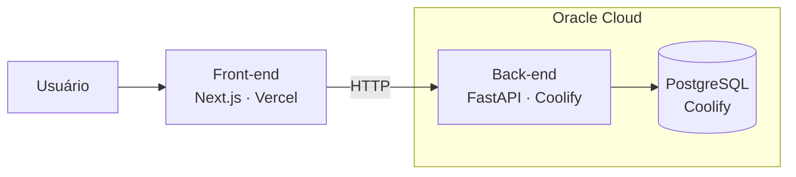

# Deploy

O Advocondo é publicado em dois ambientes separados: o front-end roda na **Vercel**, e o back-end e o banco de dados rodam em uma máquina na **Oracle Cloud**, gerenciada pelo **Coolify**.



| Parte | Repositório | Hospedagem | Como é publicado |
| --- | --- | --- | --- |
| Front-end | [`Advocondo/front`](https://github.com/Advocondo/front) | Vercel | Build automático a cada push na branch `main` |
| Back-end | [`Advocondo/back`](https://github.com/Advocondo/back) | Oracle Cloud + Coolify | Coolify faz o build da imagem Docker de produção (`Dockerfile.prod`) |
| Banco de dados | — | Oracle Cloud + Coolify | PostgreSQL gerenciado pelo mesmo Coolify do back-end |

## Front-end na Vercel

A Vercel detecta o Next.js e roda `npm run build`. Não é preciso nenhum `vercel.json`.

O `next.config.ts` usa `output: "standalone"` apenas fora da Vercel, porque essa opção é necessária para a imagem Docker (`Dockerfile`), mas quebra o build da Vercel com o erro `ENOENT: ... .next/next-server.js.nft.json`:

```ts
output: process.env.VERCEL ? undefined : "standalone",
```

A Vercel define `VERCEL=1` durante o build, então a mesma configuração serve para os dois casos.

## Back-end na Oracle Cloud com Coolify

O [Coolify](https://coolify.io) roda em uma instância da Oracle Cloud e faz o build e a execução do back-end a partir do repositório `Advocondo/back`.

- **Imagem:** `Dockerfile.prod`, um build multi-stage com `uv`. A imagem final roda como usuário não-root e sobe a API com `python -m advocondo` na porta `8000`.
- **Banco de dados:** o PostgreSQL também é um recurso do mesmo Coolify, na mesma instância. O back-end se conecta a ele pela `DATABASE_URL`.
- **Variáveis de ambiente:** são configuradas no painel do Coolify, e não no repositório. O `.env.example` lista as variáveis esperadas.
- **Migrations:** o schema do banco é atualizado pelo Alembic. Configure no Coolify o *Pre-deployment command* do back-end como `alembic upgrade head`, para que as migrations rodem antes de cada nova versão da API subir. Elas não rodam sozinhas.
- **Verificação:** a rota `GET /health` confirma se a API está no ar, e `GET /health/ready` também verifica o banco.

### Variáveis de ambiente do back-end

**Todas as variáveis do `.env.example` precisam existir no Coolify, mesmo as que ficam vazias.** A API não tem valores padrão: se faltar uma, ela não sobe e mostra no log o nome da variável que falta. Por exemplo, `INVITE_LINK_MINUTES` entrou com a [US07](../historias/ep02-usuarios-perfis.md#us07) e precisa estar cadastrada antes do deploy dessa versão. Sempre que um PR acrescentar uma variável ao `.env.example`, cadastre-a no Coolify antes do deploy.

| Grupo | Variáveis | Em produção |
| --- | --- | --- |
| Banco | `DATABASE_URL` | URL do Postgres do Coolify: `postgresql+psycopg://<usuario>:<senha>@<host>:5432/<banco>`. `POSTGRES_*` e `TEST_DATABASE_URL` são só do desenvolvimento local e dos testes. |
| Links enviados por e-mail | `FRONTEND_URL` | Endereço do front na Vercel. Os e-mails de convite e de redefinição de senha apontam para ele. |
| Redefinição de senha ([US03](../historias/ep01-portal-autenticacao.md#us03)) | `PASSWORD_RESET_LINK_MINUTES`, `PASSWORD_RESET_MAX_REQUESTS`, `PASSWORD_RESET_REQUEST_WINDOW_MINUTES` | Os valores do `.env.example`: link válido por 60 minutos e até 5 pedidos por hora. |
| Convites ([US07](../historias/ep02-usuarios-perfis.md#us07)) | `INVITE_LINK_MINUTES` | Validade do link de convite: `1440` (24 horas). |
| Sessões ([US02](../historias/ep01-portal-autenticacao.md#us02)) | `SESSION_DURATION_HOURS`, `REMEMBERED_SESSION_DURATION_DAYS` | `12` horas, ou `30` dias com "Manter conectado". |
| E-mail (SMTP) | `SMTP_HOST`, `SMTP_PORT`, `SMTP_USERNAME`, `SMTP_PASSWORD`, `SMTP_USE_TLS`, `EMAIL_FROM` | Obrigatório fora do ambiente local: sem SMTP, os e-mails de convite e de redefinição não saem. Com `ENVIRONMENT=local`, o e-mail vai só para o log. |
| Arquivos ([US24](../historias/ep03-cadastro-acordos.md#us24)) | `S3_ENDPOINT_URL`, `S3_REGION`, `S3_BUCKET`, `S3_ACCESS_KEY_ID`, `S3_SECRET_ACCESS_KEY` | Opcional. Com todas vazias, os PDFs dos acordos ficam no próprio banco. Para usar um bucket S3-compatível (Amazon S3, Cloudflare R2, Backblaze B2), preencha região, bucket e chaves; uma configuração pela metade impede a API de subir. |
| Página institucional ([US04](../historias/ep01-portal-autenticacao.md#us04)) | `LANDING_IMAGE_MAX_KILOBYTES` | `2048`: tamanho máximo de cada imagem enviada pelo Administrador. |
| Primeiro Administrador | `SETUP_TOKEN` | Vazio, exceto durante a criação do primeiro Administrador (ver abaixo). |
| Observabilidade | `ENVIRONMENT`, `RELEASE`, `LOG_LEVEL`, `LOG_FORMAT`, `SENTRY_DSN`, `SENTRY_TRACES_SAMPLE_RATE` | `ENVIRONMENT=producao` e `LOG_FORMAT=json`. `SENTRY_DSN` liga o Sentry. |
| HTTPS e CORS | `CORS_ALLOW_ORIGINS`, `CORS_ALLOW_ORIGIN_REGEX`, `CORS_ALLOW_CREDENTIALS`, `HSTS_MAX_AGE` | A URL do front em `CORS_ALLOW_ORIGINS` (nunca `*`), a regex dos previews da Vercel, `false` e `31536000`. |

Os segredos (`DATABASE_URL`, `SMTP_PASSWORD`, `S3_SECRET_ACCESS_KEY`, `SENTRY_DSN` e `SETUP_TOKEN`) ficam só no Coolify. A descrição de cada variável e a rotina de rotação de credenciais estão em `docs/segredos.md`, no repositório do back-end.

!!! warning "Provedor de e-mail ainda não escolhido"
    O back-end envia e-mails por qualquer servidor SMTP, mas o provedor de produção ainda não foi definido. Até lá, convites ([US07](../historias/ep02-usuarios-perfis.md#us07)) e redefinição de senha ([US03](../historias/ep01-portal-autenticacao.md#us03)) não funcionam em produção.

### Tarefa diária de limpeza

Sessões e links de redefinição de senha expirados são apagados por um comando que roda uma vez por dia. No Coolify, cadastre uma *Scheduled Task* no back-end, executada no container da API:

| Campo | Valor |
| --- | --- |
| Comando | `python -m advocondo.auth.cleanup` |
| Frequência | `0 3 * * *` (todo dia às 3h) |

Ao terminar, o comando mostra no log quantas sessões e links apagou. Os detalhes estão em `docs/auth.md`, no repositório do back-end.

### Checklist de cada deploy do back-end

1. Conferir se o PR acrescentou variáveis ao `.env.example` e cadastrá-las no Coolify antes do merge.
2. Confirmar que o *Pre-deployment command* é `alembic upgrade head`.
3. Depois do deploy, abrir `GET /health/ready` e conferir se a resposta é `200`.

### Primeiro deploy: criar o Administrador

Depois do primeiro deploy, crie o primeiro usuário, que será o Administrador. Os demais entram por convite dele ([US07](../historias/ep02-usuarios-perfis.md#us07)).

1. Gere um token com `openssl rand -hex 32`.
2. No Coolify, coloque esse valor na variável `SETUP_TOKEN` do back-end e faça o redeploy.
3. Crie o Administrador:

    ```bash
    curl -X POST https://<endereço-da-api>/setup \
      -H "Content-Type: application/json" \
      -H "X-Setup-Token: <token>" \
      -d '{"email": "admin@escritorio.com.br", "name": "Nome do Administrador", "password": "<senha>"}'
    ```

4. No Coolify, deixe `SETUP_TOKEN` vazio e faça o redeploy de novo.

Pronto: é só fazer login no front com esse e-mail e essa senha.

!!! warning "Trate o `SETUP_TOKEN` como uma senha"
    Não compartilhe o token e esvazie a variável logo depois de usar. A rota só cria o primeiro usuário: com alguém já cadastrado, ela recusa. Mais detalhes em `docs/auth.md`, no repositório do back-end.

!!! note "O `docker-compose.yml` é só para desenvolvimento"
    O `docker-compose.yml` do back-end usa o `Dockerfile.dev`, com hot reload e o código montado como volume. Ele não é usado em produção.

---

## Histórico de versão

| Versão | Data | Descrição | Autor |
| :----: | :--: | :-------: | :---: |
| 1.0 | 30/09/2026 | Documentação do deploy (Vercel e Oracle Cloud/Coolify). | Ciro Costa |
| 1.1 | 10/10/2026 | Migrations e criação do primeiro Administrador no deploy. | Gabriela Tiago de Araújo |
| 1.2 | 14/10/2026 | Primeiro Administrador criado pela rota POST /setup. | Gabriela Tiago de Araújo |
| 1.3 | 14/10/2026 | Simplificação dos passos do primeiro Administrador. | Gabriela Tiago de Araújo |
| 1.4 | 25/10/2026 | Variáveis de ambiente exigidas pelo back-end, tarefa diária de limpeza e checklist de deploy; inclusão do histórico de versão. | Mateus Vieira |
