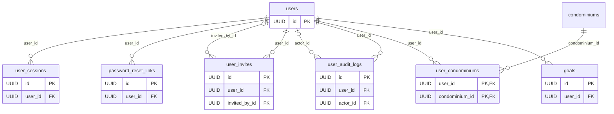
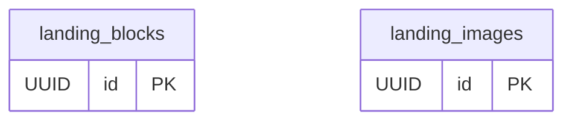

# Modelo físico do banco

O modelo físico do PostgreSQL de produção: tabelas, colunas com o tipo exato do banco, nulidade, valores padrão, chaves primárias e estrangeiras, unicidade, índices e regras `CHECK`.

!!! info "Gerado a partir do código"
    O diagrama e o dicionário abaixo são gerados dos models do back-end (`Base.metadata`, commit [`d8fba98`](https://github.com/Advocondo/back/tree/d8fba98)) pelo script [`scripts/modelo_fisico.py`](https://github.com/Advocondo/docs/blob/main/scripts/modelo_fisico.py) deste repositório, e não digitados à mão. O teste `test_upgrade_builds_the_schema_described_by_the_models` do back garante que as migrations criam exatamente esse schema (ver [Banco de dados](banco-de-dados.md#migrations)). Para atualizar, rode a partir da pasta do back-end:

    ```bash
    uv run python ../docs/scripts/modelo_fisico.py ../docs/docs/pc2/modelo-fisico.md
    ```

**Convenções aplicadas a todas as tabelas**

- Chave primária `id` do tipo `UUID`, gerada pelo banco (`gen_random_uuid()`).
- `created_at` e, nas tabelas editáveis, `updated_at`, como `TIMESTAMP WITH TIME ZONE` preenchidos pelo banco (`now()`).
- Valores em dinheiro como `NUMERIC(12, 2)`; situações (status, perfis) como `VARCHAR` com `CHECK` da lista de valores.
- As chaves estrangeiras usadas para filtrar e listar têm índice: o condomínio do devedor, o devedor e o condomínio do acordo, o acordo da parcela e o usuário da sessão. As que só registram autoria (quem editou, quem gerou o PDF, quem atribuiu o advogado) não têm.
- Os nomes de restrições seguem `pk_`, `fk_`, `uq_`, `ck_` e `ix_` + tabela + coluna.
- No diagrama, cada linha liga a tabela referenciada à que tem a chave estrangeira, com o nome da coluna. `|o` indica que a chave aceita nulo.

<!-- modelo-fisico:inicio -->

**17 tabelas**, 130 colunas e 74 restrições e índices (chaves estrangeiras, `UNIQUE`, `CHECK` e índices), sem contar as chaves primárias.

## Diagrama entidade-relacionamento

### Usuários e acesso



### Acordos e cobrança

```mermaid
erDiagram
  condominiums ||--o{ debtors : "condominium_id"
  users |o--o{ agreements : "closed_by_id"
  condominiums ||--o{ agreements : "condominium_id"
  debtors ||--o{ agreements : "debtor_id"
  users |o--o{ agreements : "responsible_lawyer_id"
  agreements ||--o{ installments : "agreement_id"
  installments ||--o{ installment_payments : "installment_id"
  agreements ||--o{ lawyer_assignments : "agreement_id"
  users ||--o{ lawyer_assignments : "assigned_by_id"
  users ||--o{ lawyer_assignments : "new_lawyer_id"
  users |o--o{ lawyer_assignments : "previous_lawyer_id"
  agreements ||--o{ agreement_edit_logs : "agreement_id"
  users ||--o{ agreement_edit_logs : "edited_by_id"
  agreements ||--o{ agreement_pdfs : "agreement_id"
  users ||--o{ agreement_pdfs : "generated_by_id"
  condominiums {
    UUID id PK
  }
  debtors {
    UUID id PK
    UUID condominium_id FK
  }
  agreements {
    UUID id PK
    UUID condominium_id FK
    UUID debtor_id FK
    UUID closed_by_id FK
    UUID responsible_lawyer_id FK
  }
  installments {
    UUID id PK
    UUID agreement_id FK
  }
  installment_payments {
    UUID id PK
    UUID installment_id FK
  }
  lawyer_assignments {
    UUID id PK
    UUID agreement_id FK
    UUID previous_lawyer_id FK
    UUID new_lawyer_id FK
    UUID assigned_by_id FK
  }
  agreement_edit_logs {
    UUID id PK
    UUID agreement_id FK
    UUID edited_by_id FK
  }
  agreement_pdfs {
    UUID id PK
    UUID agreement_id FK
    UUID generated_by_id FK
  }
```



### Página institucional



## Dicionário de dados

### `agreement_edit_logs`

| Coluna | Tipo | Nulo | Padrão | Chaves e índices |
| --- | --- | :---: | --- | --- |
| `id` | `UUID` | não | `gen_random_uuid()` | PK |
| `agreement_id` | `UUID` | não |  | FK → `agreements.id`, índice |
| `edited_by_id` | `UUID` | não |  | FK → `users.id` |
| `edited_at` | `TIMESTAMP WITH TIME ZONE` | não |  |  |
| `field` | `VARCHAR(30)` | não |  |  |
| `old_value` | `VARCHAR` | não |  |  |
| `new_value` | `VARCHAR` | não |  |  |
| `had_paid_installments` | `BOOLEAN` | não |  |  |

**Regras (`CHECK`):**

- `ck_agreement_edit_logs_agreement_edit_field`: `agreement_edit_logs.field IN ('debtor', 'total_amount', 'fee_amount')`

### `agreement_pdfs`

| Coluna | Tipo | Nulo | Padrão | Chaves e índices |
| --- | --- | :---: | --- | --- |
| `id` | `UUID` | não | `gen_random_uuid()` | PK |
| `agreement_id` | `UUID` | não |  | FK → `agreements.id`, índice |
| `generated_by_id` | `UUID` | não |  | FK → `users.id` |
| `generated_at` | `TIMESTAMP WITH TIME ZONE` | não |  |  |
| `content_type` | `VARCHAR(100)` | não |  |  |
| `size_bytes` | `INTEGER` | não |  |  |
| `content` | `BYTEA` | sim |  |  |
| `storage_key` | `VARCHAR(500)` | sim |  |  |

**Regras (`CHECK`):**

- `ck_agreement_pdfs_stored_in_one_place`: `(content IS NULL) <> (storage_key IS NULL)`

### `agreements`

| Coluna | Tipo | Nulo | Padrão | Chaves e índices |
| --- | --- | :---: | --- | --- |
| `id` | `UUID` | não | `gen_random_uuid()` | PK |
| `condominium_id` | `UUID` | não |  | FK → `condominiums.id`, índice |
| `debtor_id` | `UUID` | não |  | FK → `debtors.id`, índice |
| `closed_by_id` | `UUID` | sim |  | FK → `users.id`, índice |
| `total_amount` | `NUMERIC(12, 2)` | não |  |  |
| `fee_amount` | `NUMERIC(12, 2)` | não |  |  |
| `fee_percentage` | `NUMERIC(5, 2)` | sim |  |  |
| `status` | `VARCHAR(30)` | não | `active` |  |
| `cancelled_at` | `TIMESTAMP WITH TIME ZONE` | sim |  |  |
| `cancellation_reason` | `VARCHAR(500)` | sim |  |  |
| `responsible_lawyer_id` | `UUID` | sim |  | FK → `users.id`, índice |
| `updated_at` | `TIMESTAMP WITH TIME ZONE` | não | `now()` |  |
| `created_at` | `TIMESTAMP WITH TIME ZONE` | não | `now()` |  |

**Regras (`CHECK`):**

- `ck_agreements_agreement_status`: `agreements.status IN ('active', 'cancelled')`
- `ck_agreements_fee_amount_within_total`: `fee_amount >= 0 AND fee_amount <= total_amount`
- `ck_agreements_fee_percentage_within_range`: `fee_percentage >= 0 AND fee_percentage <= 100`
- `ck_agreements_total_amount_is_positive`: `total_amount > 0`

### `condominiums`

| Coluna | Tipo | Nulo | Padrão | Chaves e índices |
| --- | --- | :---: | --- | --- |
| `id` | `UUID` | não | `gen_random_uuid()` | PK |
| `name` | `VARCHAR(200)` | não |  |  |
| `cnpj` | `VARCHAR(14)` | sim |  | único |
| `zip_code` | `VARCHAR(8)` | sim |  |  |
| `street` | `VARCHAR(200)` | sim |  |  |
| `neighborhood` | `VARCHAR(200)` | sim |  |  |
| `city` | `VARCHAR(200)` | sim |  |  |
| `state` | `VARCHAR(2)` | sim |  |  |
| `manager_name` | `VARCHAR(200)` | sim |  |  |
| `manager_email` | `VARCHAR(254)` | sim |  |  |
| `manager_phone` | `VARCHAR(11)` | sim |  |  |
| `contract_start_date` | `DATE` | sim |  |  |
| `contract_renewal_date` | `DATE` | sim |  |  |
| `updated_at` | `TIMESTAMP WITH TIME ZONE` | não | `now()` |  |
| `created_at` | `TIMESTAMP WITH TIME ZONE` | não | `now()` |  |

**Regras (`CHECK`):**

- `ck_condominiums_renewal_not_before_start`: `contract_renewal_date >= contract_start_date`

### `debtors`

| Coluna | Tipo | Nulo | Padrão | Chaves e índices |
| --- | --- | :---: | --- | --- |
| `id` | `UUID` | não | `gen_random_uuid()` | PK |
| `condominium_id` | `UUID` | não |  | FK → `condominiums.id`, índice |
| `name` | `VARCHAR(200)` | não |  |  |
| `unit` | `VARCHAR(50)` | não |  |  |
| `phone` | `VARCHAR(11)` | sim |  |  |
| `email` | `VARCHAR(254)` | sim |  |  |
| `updated_at` | `TIMESTAMP WITH TIME ZONE` | não | `now()` |  |
| `created_at` | `TIMESTAMP WITH TIME ZONE` | não | `now()` |  |

**Regras (`CHECK`):**

- `ck_debtors_has_a_contact`: `phone IS NOT NULL OR email IS NOT NULL`

### `goals`

| Coluna | Tipo | Nulo | Padrão | Chaves e índices |
| --- | --- | :---: | --- | --- |
| `id` | `UUID` | não | `gen_random_uuid()` | PK |
| `user_id` | `UUID` | não |  | FK → `users.id`, único (user_id, year, month) |
| `year` | `SMALLINT` | não |  | único (user_id, year, month) |
| `month` | `SMALLINT` | não |  | único (user_id, year, month) |
| `target_amount` | `NUMERIC(12, 2)` | não |  |  |
| `updated_at` | `TIMESTAMP WITH TIME ZONE` | não | `now()` |  |
| `created_at` | `TIMESTAMP WITH TIME ZONE` | não | `now()` |  |

**Regras (`CHECK`):**

- `ck_goals_month_is_valid`: `month BETWEEN 1 AND 12`
- `ck_goals_target_amount_is_positive`: `target_amount > 0`

### `installment_payments`

| Coluna | Tipo | Nulo | Padrão | Chaves e índices |
| --- | --- | :---: | --- | --- |
| `id` | `UUID` | não | `gen_random_uuid()` | PK |
| `installment_id` | `UUID` | não |  | FK → `installments.id`, índice |
| `amount` | `NUMERIC(12, 2)` | não |  |  |
| `payment_date` | `DATE` | não |  |  |
| `created_at` | `TIMESTAMP WITH TIME ZONE` | não | `clock_timestamp()` |  |

**Regras (`CHECK`):**

- `ck_installment_payments_amount_is_positive`: `amount > 0`

### `installments`

| Coluna | Tipo | Nulo | Padrão | Chaves e índices |
| --- | --- | :---: | --- | --- |
| `id` | `UUID` | não | `gen_random_uuid()` | PK |
| `agreement_id` | `UUID` | não |  | FK → `agreements.id`, único (agreement_id, number), índice |
| `number` | `INTEGER` | não |  | único (agreement_id, number) |
| `due_date` | `DATE` | não |  |  |
| `amount` | `NUMERIC(12, 2)` | não |  |  |
| `condominium_amount` | `NUMERIC(12, 2)` | não |  |  |
| `fee_amount` | `NUMERIC(12, 2)` | não |  |  |
| `payment_date` | `DATE` | sim |  |  |
| `paid_amount` | `NUMERIC(12, 2)` | não | `0` |  |
| `invoice_number` | `VARCHAR(15)` | sim |  |  |
| `invoice_date` | `DATE` | sim |  |  |
| `updated_at` | `TIMESTAMP WITH TIME ZONE` | não | `now()` |  |
| `created_at` | `TIMESTAMP WITH TIME ZONE` | não | `now()` |  |

**Regras (`CHECK`):**

- `ck_installments_amount_is_positive`: `amount > 0`
- `ck_installments_invoice_number_and_date_together`: `(invoice_number IS NULL) = (invoice_date IS NULL)`
- `ck_installments_number_is_positive`: `number > 0`
- `ck_installments_paid_amount_within_amount`: `paid_amount >= 0 AND paid_amount <= amount`
- `ck_installments_paid_only_when_fully_paid`: `(payment_date IS NOT NULL) = (paid_amount = amount)`
- `ck_installments_split_adds_up_to_amount`: `condominium_amount + fee_amount = amount`
- `ck_installments_split_not_negative`: `condominium_amount >= 0 AND fee_amount >= 0`

### `landing_blocks`

| Coluna | Tipo | Nulo | Padrão | Chaves e índices |
| --- | --- | :---: | --- | --- |
| `id` | `UUID` | não | `gen_random_uuid()` | PK |
| `key` | `VARCHAR(30)` | não |  | único |
| `content` | `JSONB` | não |  |  |
| `updated_at` | `TIMESTAMP WITH TIME ZONE` | não | `now()` |  |
| `created_at` | `TIMESTAMP WITH TIME ZONE` | não | `now()` |  |

**Regras (`CHECK`):**

- `ck_landing_blocks_landing_block_key`: `landing_blocks.key IN ('hero', 'practice_areas', 'online_service', 'condominium_advisory', 'reviews', 'why_us', 'team', 'contact_form', 'visit', 'contact')`

### `landing_images`

| Coluna | Tipo | Nulo | Padrão | Chaves e índices |
| --- | --- | :---: | --- | --- |
| `id` | `UUID` | não | `gen_random_uuid()` | PK |
| `media_type` | `VARCHAR(30)` | não |  |  |
| `data` | `BYTEA` | não |  |  |
| `created_at` | `TIMESTAMP WITH TIME ZONE` | não | `now()` |  |

**Regras (`CHECK`):**

- `ck_landing_images_image_media_type`: `landing_images.media_type IN ('image/png', 'image/jpeg', 'image/webp')`

### `lawyer_assignments`

| Coluna | Tipo | Nulo | Padrão | Chaves e índices |
| --- | --- | :---: | --- | --- |
| `id` | `UUID` | não | `gen_random_uuid()` | PK |
| `agreement_id` | `UUID` | não |  | FK → `agreements.id`, índice |
| `previous_lawyer_id` | `UUID` | sim |  | FK → `users.id` |
| `new_lawyer_id` | `UUID` | não |  | FK → `users.id` |
| `assigned_by_id` | `UUID` | não |  | FK → `users.id` |
| `assigned_at` | `TIMESTAMP WITH TIME ZONE` | não |  |  |

### `password_reset_links`

| Coluna | Tipo | Nulo | Padrão | Chaves e índices |
| --- | --- | :---: | --- | --- |
| `id` | `UUID` | não | `gen_random_uuid()` | PK |
| `user_id` | `UUID` | não |  | FK → `users.id`, índice |
| `token_hash` | `VARCHAR(64)` | não |  | único |
| `expires_at` | `TIMESTAMP WITH TIME ZONE` | não |  |  |
| `created_at` | `TIMESTAMP WITH TIME ZONE` | não | `now()` |  |

### `user_audit_logs`

| Coluna | Tipo | Nulo | Padrão | Chaves e índices |
| --- | --- | :---: | --- | --- |
| `id` | `UUID` | não | `gen_random_uuid()` | PK |
| `user_id` | `UUID` | não |  | FK → `users.id`, índice |
| `actor_id` | `UUID` | sim |  | FK → `users.id` |
| `action` | `VARCHAR(30)` | não |  |  |
| `old_value` | `VARCHAR(255)` | sim |  |  |
| `new_value` | `VARCHAR(255)` | sim |  |  |
| `details` | `JSONB` | sim |  |  |
| `created_at` | `TIMESTAMP WITH TIME ZONE` | não | `clock_timestamp()` |  |

**Regras (`CHECK`):**

- `ck_user_audit_logs_audit_action`: `user_audit_logs.action IN ('invited', 'status_changed', 'role_changed', 'condominiums_changed')`

### `user_condominiums`

| Coluna | Tipo | Nulo | Padrão | Chaves e índices |
| --- | --- | :---: | --- | --- |
| `user_id` | `UUID` | não |  | PK, FK → `users.id` |
| `condominium_id` | `UUID` | não |  | PK, FK → `condominiums.id`, índice |
| `created_at` | `TIMESTAMP WITH TIME ZONE` | não | `now()` |  |

### `user_invites`

| Coluna | Tipo | Nulo | Padrão | Chaves e índices |
| --- | --- | :---: | --- | --- |
| `id` | `UUID` | não | `gen_random_uuid()` | PK |
| `user_id` | `UUID` | não |  | FK → `users.id`, único, índice |
| `invited_by_id` | `UUID` | sim |  | FK → `users.id`, índice |
| `token_hash` | `VARCHAR(64)` | não |  | único |
| `expires_at` | `TIMESTAMP WITH TIME ZONE` | não |  |  |
| `created_at` | `TIMESTAMP WITH TIME ZONE` | não | `now()` |  |

### `user_sessions`

| Coluna | Tipo | Nulo | Padrão | Chaves e índices |
| --- | --- | :---: | --- | --- |
| `id` | `UUID` | não | `gen_random_uuid()` | PK |
| `user_id` | `UUID` | não |  | FK → `users.id`, índice |
| `token_hash` | `VARCHAR(64)` | não |  | único |
| `expires_at` | `TIMESTAMP WITH TIME ZONE` | não |  |  |
| `created_at` | `TIMESTAMP WITH TIME ZONE` | não | `now()` |  |

### `users`

| Coluna | Tipo | Nulo | Padrão | Chaves e índices |
| --- | --- | :---: | --- | --- |
| `id` | `UUID` | não | `gen_random_uuid()` | PK |
| `email` | `VARCHAR(254)` | não |  | único |
| `name` | `VARCHAR(200)` | não |  |  |
| `role` | `VARCHAR(30)` | não |  |  |
| `status` | `VARCHAR(30)` | não | `pending` |  |
| `password_hash` | `VARCHAR(255)` | sim |  |  |
| `is_lawyer` | `BOOLEAN` | não | `False` |  |
| `oab_number` | `VARCHAR(12)` | sim |  |  |
| `monthly_goal` | `NUMERIC(12, 2)` | não | `0.00` |  |
| `updated_at` | `TIMESTAMP WITH TIME ZONE` | não | `now()` |  |
| `created_at` | `TIMESTAMP WITH TIME ZONE` | não | `now()` |  |

**Regras (`CHECK`):**

- `ck_users_active_user_has_password`: `status <> 'active' OR password_hash IS NOT NULL`
- `ck_users_email_is_lowercase`: `email = lower(email)`
- `ck_users_lawyer_has_valid_oab_number`: `(NOT is_lawyer AND oab_number IS NULL) OR (is_lawyer AND oab_number IS NOT NULL AND char_length(oab_number) BETWEEN 8 AND 12)`
- `ck_users_role`: `users.role IN ('admin', 'operator', 'client')`
- `ck_users_user_status`: `users.status IN ('pending', 'active', 'inactive')`

<!-- modelo-fisico:fim -->

---

## Histórico de versão

| Versão | Data | Descrição | Autor |
| :----: | :--: | :-------: | :---: |
| 1.0 | 25/10/2026 | Criação do modelo físico (diagrama ER e dicionário de dados) gerado dos models do back-end. | Mateus Vieira |
